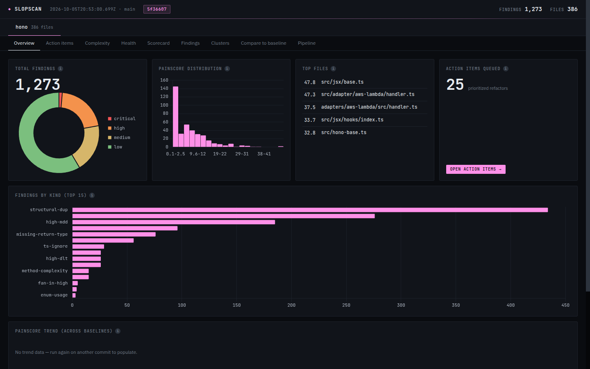

# slopscan

Point slopscan at a JavaScript, TypeScript or Vue repo and it tells you where the pain is. It runs a set of static analyzers, covering complexity, copy-paste, near-duplicate logic found with embeddings, dead code, churn, type-safety escapes, import cycles, bundle weight and vulnerable dependencies. It folds every signal into one **painscore** per file and writes an interactive HTML dashboard with a ranked list of concrete refactor targets. It was built to find the slop that piles up quickly in AI-assisted codebases: the same helper written three times under three names, 400-line components, `as any` sprinkled around to make the compiler stop complaining. It works just as well on code written by hand.



## Quickstart

```bash
npx github:Hugo0/slopscan ./path/to/repo           # → ./slopscan-report/index.html
# or
git clone https://github.com/Hugo0/slopscan && cd slopscan && pnpm install
node bin/slopscan.mjs ../my-app --out /tmp/report
```

```
slopscan [path] [--out dir] [--preset react-next|node-ts|vue-nuxt|./preset.mjs]
         [--no-semantic] [--analyzers a,b | +a,-b] [--include src,lib]
         [--baseline [ref]] [--save-baseline] [--llm-review] [--since "6 months ago"]
```

Open `slopscan-report/index.html` in a browser. `SUMMARY.md` holds the same action items as markdown, and `<label>/findings.json` and `scorecard.json` are the raw machine-readable output.

Requirements: Node 20 or newer, and `git` for churn. Install the target repo's dependencies first if you want dead-code (knip), `tsc` type errors and bundle weights; without `node_modules`, dead-code is skipped and the others degrade gracefully.

## What it detects

| Analyzer | Finds | Engine |
|---|---|---|
| `complexity` | cyclomatic complexity, maintainability index, hot methods | escomplex |
| `cognitive` | nesting depth, decision density (MDD / DLT) | ts-morph |
| `structural-dup` | copy-paste clones | jscpd |
| `semantic-dup` | functions and templates that *do the same thing* under different names, clustered by embedding similarity | OpenAI-compatible embeddings |
| `dead-code` | unused files, exports, types, dependencies | knip |
| `import-graph` | import cycles and high fan-in hubs | built in |
| `churn` | files that change all the time (git log) | git |
| `type-errors` | `tsc --noEmit` errors, `any` counts | tsc |
| `ts-quality` | `@ts-ignore`, non-null assertions, missing return types, banned types | ts-morph |
| `react` / `nextjs` | hook and render anti-patterns, App Router misuse | pattern rules |
| `bundle-size` | heaviest files by transitive import weight (from installed packages) | built in |
| `supply-chain` | `npm`/`pnpm audit` advisories, deprecated packages | package manager |
| `schema-casing` | mixed snake/camel casing in schemas | built in |
| `coverage`, `lint` | low coverage from an lcov file, eslint JSON | opt-in |

Vue, Svelte, Astro and MDX files are preprocessed so their `<script>` blocks are analyzed as TS/JS. Vue `<template>` blocks also take part in semantic duplication.

## The painscore

Each analyzer emits per-file raw signals, such as cyclomatic complexity, churn commits, duplicate-cluster memberships and `any` count. Each signal is **normalized to 0–100 against the worst file in the repo** and then combined as a weighted sum:

```
painscore(file) = Σ weight[signal] × normalized[signal](file)
```

The default weights (`lib/core/painscore.mjs`) favour what predicts real maintenance pain:

- complexity 0.16
- churn 0.12
- structural and semantic duplication 0.08 each
- inverse maintainability 0.08
- type errors 0.06
- cognitive load 0.11
- smaller weights for size, fan-in, cycles, `any`, dead exports, coverage and framework anti-patterns

Presets nudge the weights, and `--weights '{"churn":0.2}'` overrides them. Because scores are relative to the repo, a painscore compares files *within* a codebase, not across codebases. The dashboard shows each file's per-signal breakdown, so you can always see *why* a file ranks high.

## Presets

The preset is auto-detected from `package.json` when you don't pass `--preset`:

| Preset | Picked when | Notes |
|---|---|---|
| `vue-nuxt` | `vue` or `nuxt` dependency | `vue-aware` chunk filter. dead-code and type-errors are **off** (see Limitations). |
| `react-next` | `react`, `next` or `preact` dependency | adds `react`, `nextjs` and `bundle-size`, with a JSX-aware chunk filter |
| `node-ts` | everything else | adds `schema-casing` and weights cycles and dead exports higher |

A preset is a plain ES module (see `presets/`). Pass your own with `--preset ./my-preset.mjs`. Any CLI flag overrides the preset. `--analyzers +dead-code,-churn` edits the preset's analyzer list instead of replacing it.

## Semantic duplication and embeddings

`semantic-dup` embeds every exported function, component and template chunk, then clusters pairs above a cosine threshold (`--threshold`, default 0.82). Vectors are cached on disk by `sha256(model + text)` under `<out>/.cache`, so re-runs only embed changed code. A cold run on a ~300-file repo costs well under $0.01 with `text-embedding-3-small`.

| Env var | Effect |
|---|---|
| `OPENAI_API_KEY` | use OpenAI (`https://api.openai.com/v1`, `text-embedding-3-small`) |
| `OPENROUTER_API_KEY` | used when no OpenAI key is set: `https://openrouter.ai/api/v1`, `openai/text-embedding-3-small` |
| `SLOPSCAN_EMBED_BASE_URL` | any OpenAI-compatible `/embeddings` endpoint |
| `SLOPSCAN_EMBED_MODEL` | override the model |
| `ANTHROPIC_API_KEY` | only for `--llm-review` (Claude reviews the top-N files) |

Keys are read from the environment, then from any `--env-file`, then from `~/.config/slopscan/.env`. slopscan never reads the scanned repo's own `.env`, and it never prints keys. With no key set, semantic-dup is skipped with a banner in the dashboard and everything else still runs. `--no-semantic` skips it explicitly.

## Baselines and CI

```bash
slopscan . --save-baseline        # snapshot keyed by git sha into <out>/baselines/
slopscan . --baseline auto        # diff against the most recent: added/resolved findings, painscore delta, trend chart
node bin/diff.mjs --root . --since main --preset node-ts --out diff.md   # PR-style diff
```

`examples/github-action.yml` is a workflow that comments the diff on every PR.

## Limitations

- **Auto-imports (Nuxt, unplugin-auto-import, …).** Static import-graph tools can't see auto-imported components and composables, so knip reports live code as unused. That's why `dead-code` is **off by default** in `vue-nuxt`. Turn it on with `--analyzers +dead-code` if your project imports explicitly or has a tuned knip config. For the same reason, `import-graph` fan-in and cycle signals under-count in auto-import projects.
- **Vue type checking.** Plain `tsc` can't check `.vue` files, so `type-errors` is off for `vue-nuxt`. Use `vue-tsc` / `nuxi typecheck`.
- **Dependencies must be installed** for `dead-code`, `type-errors` and `bundle-size`, which load the project's own config, types and packages.
- **The painscore is relative.** It ranks files within one repo. Absolute values aren't comparable between repos.
- **Semantic-dup sends code to the embeddings provider you configure.** Use `--no-semantic` for code that must not leave the machine, or point `SLOPSCAN_EMBED_BASE_URL` at a local OpenAI-compatible server.
- Only JS/TS-family languages are supported.
- Very large monorepos work, but they're slow. Use `--include` to scope the scan, or `bin/analyze.mjs --workspace` to run per package.

## Layout

```
bin/slopscan.mjs        CLI entry: preset detection, run, dashboard, baselines
bin/analyze.mjs         low-level runner (every flag; per-run findings/scorecard)
bin/diff.mjs            diff two runs or two git refs
lib/core/               findings schema, orchestrator, painscore, baselines, diff
lib/analyzers/          one plugin per analyzer: run({ root, walk, cfg }) → { findings, rawSignals, stats }
lib/preprocessors/      vue / svelte / astro / mdx → script
lib/filters/            which chunks are worth embedding
lib/render/             HTML dashboard + markdown
presets/                react-next, node-ts, vue-nuxt
```

To add an analyzer, drop a file in `lib/analyzers/` that exports `run()` and returns findings plus per-file raw signals. If it introduces a new signal, give that signal a weight in `lib/core/painscore.mjs`.

## Development

```bash
pnpm install
pnpm test
```

## License

MIT © Hugo Montenegro
